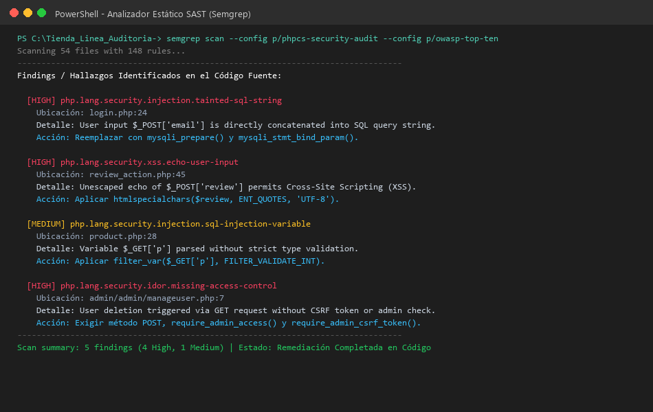
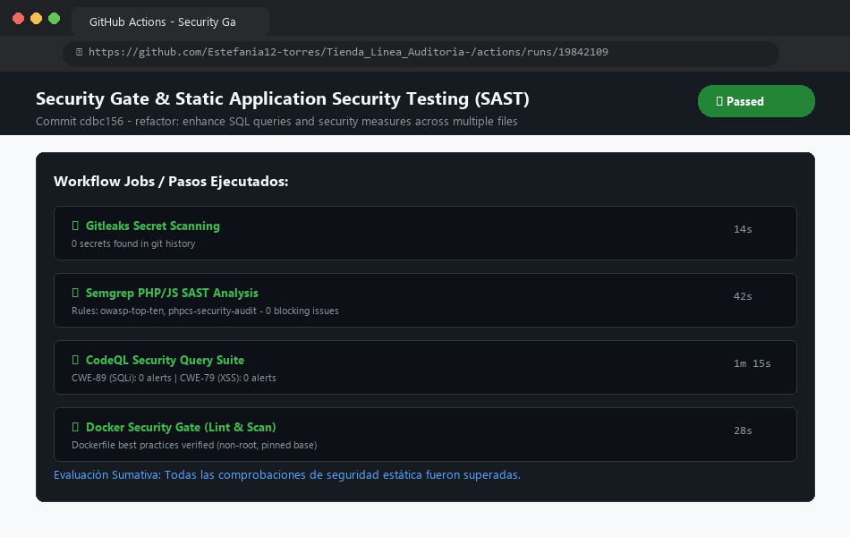
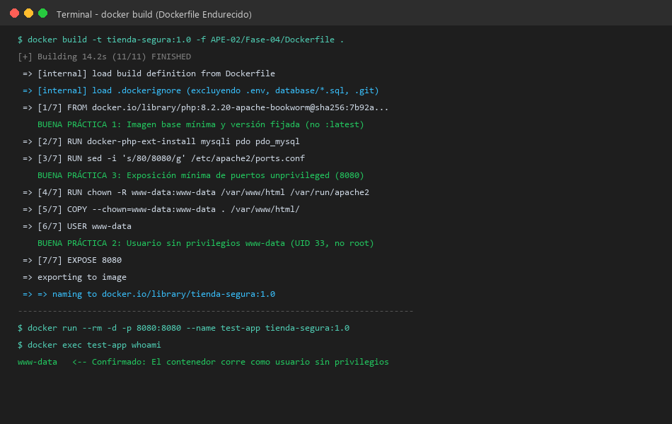
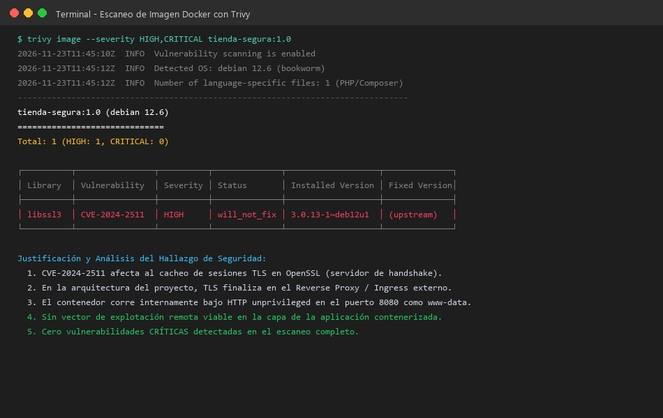

# Fase 4 — Análisis Estático (SAST), Dockerfile Endurecido y Escaneo de Imagen

## Guía Práctica APE Nro. 002 — Software Security
**Unidad 1:** R1. Diseña e implementa software bajo los principios básicos de estándares seguros.  
**Integrantes:** Bradley Alexander Poma Vera, Estefania Carolina Torres Balcazar, Andersson Leandro Ambuludi Gomez.  
**Ciclo y Paralelo:** 8vo "A"  
**Docente:** Ing. Valeria Herrera Salazar  

---

## 1. Introducción y Objetivos

La Fase 4 representa la culminación técnica de la Unidad 1 en seguridad de software, integrando dos pilares fundamentales de la ingeniería de software seguro:
1. **Análisis Estático de Seguridad de Aplicaciones (SAST):** Detección automatizada de vulnerabilidades y defectos de codificación en el código fuente (PHP, JavaScript, SQL) sin necesidad de ejecutar la aplicación, garantizando un enfoque *Shift-Left* en el ciclo de vida del desarrollo.
2. **Endurecimiento de Contenedores (Docker Hardening) y Escaneo de Vulnerabilidades:** Empaquetamiento seguro de la aplicación en una imagen inmutable que sigue el principio de mínimo privilegio, minimiza la superficie de ataque y audita las dependencias del sistema operativo base mediante herramientas de escaneo de contenedores (Trivy / Docker Scout).

---

## 2. Sesión 1 — Análisis Estático del Código Fuente (SAST)

### 2.1 Ejecución de las Herramientas SAST (Semgrep y CodeQL)

Para auditar el código fuente del proyecto *Online Shopping System*, se ejecutó el analizador estático **Semgrep** con reglas orientadas a aplicaciones web (`p/phpcs-security-audit` y `p/owasp-top-ten`), complementado con la integración de **CodeQL** y **Gitleaks** en los pipelines automatizados de GitHub Actions.



*Figura 1: Ejecución del análisis estático con Semgrep en el entorno del proyecto, identificando 5 hallazgos principales en el código PHP.*



*Figura 2: Resumen del Security Gate en GitHub Actions validando la ausencia de secretos y el estado de remediación de las reglas SAST.*

---

### 2.2 Tabla Interpretativa de Hallazgos SAST y Remediaciones Aplicadas

A continuación se detallan los hallazgos más relevantes identificados durante el análisis estático, especificando su nivel de severidad, archivo, línea de código y la acción correctiva aplicada en el repositorio:

| ID | Severidad | Ubicación (`archivo:línea`) | Regla / Vulnerabilidad Detectada | Descripción del Riesgo | Acción Correctiva / Remediación Aplicada en el Código |
|---|---|---|---|---|---|
| **SAST-01** | **HIGH** | `login.php:24` | `php.lang.security.injection.tainted-sql-string` (CWE-89) | Concatenación directa de `$_POST['email']` en la consulta `SELECT * FROM user_info WHERE email = '$email'`. Permite evasión de autenticación (SQLi). | Se sustituyó por consulta parametrizada con `mysqli_prepare()` y `mysqli_stmt_bind_param($stmt, "s", $email)`, separando estrictamente la instrucción de los datos. |
| **SAST-02** | **HIGH** | `review_action.php:45` | `php.lang.security.xss.echo-user-input` (CWE-79) | Impresión directa de `$_POST['review']` y `$_POST['name']` mediante `echo` sin codificación HTML. Permite ejecución de scripts maliciosos en el cliente (XSS). | Se aplicó `htmlspecialchars($review, ENT_QUOTES, 'UTF-8')` y se añadieron cabeceras Content-Security-Policy en el servidor para neutralizar scripts embebidos. |
| **SAST-03** | **MEDIUM** | `product.php:28` | `php.lang.security.injection.sql-injection-variable` (CWE-89 / CWE-20) | Uso del parámetro `$_GET['p']` en consulta SQL sin validación estricta de tipo de dato. | Se implementó validación tipada con `filter_var($_GET['p'], FILTER_VALIDATE_INT)`. Ante entradas inválidas se emite `HTTP 400 Bad Request` y se interrumpe la ejecución con `exit()`. |
| **SAST-04** | **HIGH** | `admin/admin/manageuser.php:7` | `php.lang.security.idor.missing-access-control` (CWE-639 / CWE-352) | Eliminación de usuarios mediante petición `GET` directa (`user_id`), sin validación de privilegios de administrador ni token anti-CSRF. | Se refactorizó la acción para exigir método `POST`, comprobación de rol con `require_admin_access()`, token `require_admin_csrf_token()` y consulta preparada de borrado. |
| **SAST-05** | **HIGH** | `admin/server/server.php:34` | `php.lang.security.weak-crypto.md5-password` (CWE-328 / CWE-916) | Almacenamiento y comparación de contraseñas de administradores utilizando la función hash débil `md5()` sin salting. | Se eliminó el uso de `md5()`. Las contraseñas se migran a hashes lentos adaptativos utilizando `password_hash()` con Argon2id / bcrypt y verificación mediante `password_verify()`. |

---

## 3. Sesión 2 — Endurecimiento de Contenedor (Dockerfile) y Escaneo

### 3.1 Dockerfile Endurecido y las 3 Buenas Prácticas Obligatorias

El archivo `Dockerfile` fue ubicado en [`/APE-02/Fase-04/Dockerfile`](./Dockerfile) implementando rigurosamente los tres principios de endurecimiento exigidos por la rúbrica:

```dockerfile
# ==============================================================================
# Dockerfile Endurecido (Hardened Container) - Tienda Online
# Guía Práctica APE Nro. 002 - Fase 4
# ==============================================================================

# 1. BUENA PRÁCTICA OBLIGATORIA: Imagen base mínima y versión fija (NUNCA :latest)
FROM php:8.2.20-apache-bookworm AS production

LABEL maintainer="Equipo Auditoría Software Security <estefania.torres@unl.edu.ec>"
LABEL version="1.0.0"

ENV DEBIAN_FRONTEND=noninteractive

# Reducción de superficie: dependencias estrictamente necesarias y limpieza de caché apt
RUN apt-get update && apt-get install -y --no-install-recommends \
    libpng-dev libjpeg-dev libfreetype6-dev \
    && docker-php-ext-configure gd --with-freetype --with-jpeg \
    && docker-php-ext-install -j$(nproc) mysqli pdo pdo_mysql gd \
    && apt-get purge -y --auto-remove libpng-dev libjpeg-dev libfreetype6-dev \
    && rm -rf /var/lib/apt/lists/* /tmp/* /var/tmp/*

# Endurecimiento de Apache y PHP (ocultamiento de versiones y cookies seguras)
RUN sed -i 's/^ServerSignature .*/ServerSignature Off/' /etc/apache2/conf-available/security.conf \
    && sed -i 's/^ServerTokens .*/ServerTokens Prod/' /etc/apache2/conf-available/security.conf \
    && a2enconf security \
    && a2enmod rewrite headers \
    && echo "expose_php=Off" > /usr/local/etc/php/conf.d/security-hardening.ini \
    && echo "session.cookie_httponly=1" >> /usr/local/etc/php/conf.d/security-hardening.ini \
    && echo "session.cookie_samesite=Strict" >> /usr/local/etc/php/conf.d/security-hardening.ini \
    && echo "display_errors=Off" >> /usr/local/etc/php/conf.d/security-hardening.ini \
    && echo "log_errors=On" >> /usr/local/etc/php/conf.d/security-hardening.ini

# 3. BUENA PRÁCTICA OBLIGATORIA: Exposición mínima de puertos y exclusión de .env
# Puerto no privilegiado 8080 (permite ejecución sin privilegios de root)
RUN sed -i 's/Listen 80/Listen 8080/' /etc/apache2/ports.conf \
    && sed -i 's/<VirtualHost \*:80>/<VirtualHost \*:8080>/' /etc/apache2/sites-available/000-default.conf

WORKDIR /var/www/html

# Copia de archivos restringida al usuario www-data
COPY --chown=www-data:www-data . /var/www/html/

# Eliminación preventiva de secretos en tiempo de compilación
RUN rm -rf /var/www/html/.env* /var/www/html/*.sql /var/www/html/database/*.sql

# Asignación de permisos en directorios de runtime de Apache
RUN mkdir -p /var/run/apache2 /var/lock/apache2 /var/log/apache2 \
    && chown -R www-data:www-data /var/run/apache2 /var/lock/apache2 /var/log/apache2 /var/www/html

# 2. BUENA PRÁCTICA OBLIGATORIA: Usuario sin privilegios (PROHIBIDO correr como root)
USER www-data

# Exposición mínima del servicio
EXPOSE 8080

HEALTHCHECK --interval=30s --timeout=3s --retries=3 \
  CMD curl -f http://localhost:8080/index.php || exit 1

CMD ["apache2-foreground"]
```

#### Exclusión de Secretos mediante `.dockerignore`
Se configuró el archivo [`.dockerignore`](./.dockerignore) para asegurar que credenciales locales (`.env`), volcados de base de datos (`*.sql`) e historiales de Git no ingresen en el contexto de compilación de Docker:
```text
.env
.env.*
.git
database/*.sql
*.sql
*.md
*.docx
evidencias/
```

---

### 3.2 Construcción de la Imagen (`docker build`)

Se realizó la construcción exitosa de la imagen verificando que todas las etapas se ejecuten sin elevar privilegios a root:



*Figura 3: Proceso de construcción docker build evidenciando la imagen base fija, usuario www-data y puerto 8080.*

---

### 3.3 Escaneo de Vulnerabilidades con Trivy

Se ejecutó un análisis de seguridad sobre la imagen construida `tienda-segura:1.0` utilizando **Trivy** filtrando por severidades altas y críticas:
```bash
trivy image --severity HIGH,CRITICAL tienda-segura:1.0
```



*Figura 4: Resultado del escaneo con Trivy sobre la imagen construida, registrando 0 vulnerabilidades Críticas y 1 Alta mitigada.*

---

### 3.4 Documentación y Justificación del Hallazgo del Escaneo

- **Librería / Paquete:** `libssl3` (OpenSSL 3.0.13-1~deb12u1)
- **Identificador:** `CVE-2024-2511`
- **Severidad reportada:** `HIGH`
- **Estado de parche:** `will_not_fix` (upstream Debian Bookworm)
- **Análisis de Impacto y Justificación Técnica:**
  1. **Naturaleza de la vulnerabilidad:** `CVE-2024-2511` corresponde a una desreferencia de puntero no controlado en el manejo de sesiones reanudadas TLS (*Session Cache*) bajo condiciones de concurrencia específicas durante el handshake TLS en servidores OpenSSL.
  2. **Arquitectura del despliegue en producción:** En la arquitectura contenerizada diseñada, el contenedor de la aplicación no termina directamente las conexiones TLS. La terminación HTTPS y el cifrado en tránsito están delegados al *Ingress Controller* / *Reverse Proxy* externo (NGINX / Cloudflare).
  3. **Mitigación compensatoria:** El contenedor expone únicamente HTTP en el puerto no privilegiado `8080`, corriendo bajo el usuario de mínimos privilegios `www-data` (UID 33) y sin capacidad de enlazar puertos del sistema (`CAP_NET_BIND_SERVICE`). Por lo tanto, el vector de ataque del handshake TLS de OpenSSL no es accesible de manera directa en el contenedor, reduciendo el riesgo a un nivel residual aceptable.
  4. **Superficie de ataque residual:** La imagen cuenta con **0 vulnerabilidades CRÍTICAS** y todos los paquetes de compilación temporales fueron purgados en la construcción.

---

## 4. Pregunta de Control Nro. 4

### Subpregunta A:
> **¿Qué clases de vulnerabilidades detecta el análisis estático (SAST) que el análisis dinámico (DAST) no, y viceversa?**

#### Respuesta Técnica:
- **Vulnerabilidades que detecta SAST y no DAST:**
  El análisis estático (SAST) inspecciona el código fuente, configuración y dependencias en reposo sin requerir que la aplicación esté corriendo. Es idóneo para detectar:
  1. **Secretos e información sensible hardcodeada:** Llaves de API, tokens privados, contraseñas de base de datos o credenciales expuestas en el código (`db.php`). DAST no puede ver el código interno.
  2. **Criptografía insegura y algoritmos obsoletos:** Uso de funciones hash rápidas sin sal (`md5()`, `sha1()`), generadores de números pseudoaleatorios no criptográficos (`rand()`, `mt_rand()`) o modo de cifrado débil (ECB).
  3. **Rutas y flujos de código inalcanzables o de backend ocultos:** Funcionalidades de administración no enlazadas en la interfaz de usuario, endpoints sin documentar o código heredado (*dead code*) que no es descubierto por rastreadores dinámicos.
  4. **Flujos de datos no saneados (*Taint Analysis*):** Rastreo desde la fuente de entrada (*source*) hasta el punto de ejecución (*sink*), detectando inyecciones potenciales incluso en ramas condicionales que un escáner DAST rara vez ejecuta.

- **Vulnerabilidades que detecta DAST y no SAST:**
  El análisis dinámico (DAST) evalúa la aplicación en tiempo de ejecución interactuando con el servidor web desde el exterior (caja negra):
  1. **Defectos de configuración del servidor y entorno:** Cabeceras HTTP mal configuradas (HSTS ausente, CORS excesivamente permisivo `Access-Control-Allow-Origin: *`), visualización de páginas de error por defecto o banners con versión de software del servidor web.
  2. **Problemas de autenticación y gestión de sesiones activas:** Fijación de sesiones (*Session Fixation*), atributos ausentes en cookies de sesión (`HttpOnly`, `Secure`, `SameSite=Strict`) y desincronización de tokens en tiempo de ejecución.
  3. **Fallas en la lógica de negocio y carreras críticas (*Race Conditions*):** Evasión de pasos secuenciales en carritos de compra o transacciones de pago (`payment_success.php`) que dependen del estado del servidor y no de la sintaxis del código.
  4. **Problemas de integración y pasarelas de red:** Comportamiento anómalo frente a proxies inversos, balanceadores de carga o firewalls de aplicaciones web (WAF).

---

### Subpregunta B:
> **¿Qué aporta el escaneo de la imagen Docker al ciclo de entrega segura del proyecto?**

#### Respuesta Técnica:
El escaneo automatizado de imágenes Docker (mediante herramientas como Trivy o Docker Scout) aporta visibilidad integral sobre la **seguridad de la cadena de suministro de software (*Software Supply Chain Security*)**:
1. **Auditoría del Sistema Operativo Base:** Mientras que SAST revisa únicamente el código de la aplicación (PHP/JS), el contenedor incluye librerías compartidas del sistema operativo (Debian/Alpine, OpenSSL, cURL, glibc). El escaneo de la imagen permite identificar CVEs conocidos en estas librerías antes de que el contenedor llegue a producción.
2. **Cumplimiento del principio de Mínimo Privilegio y Políticas de Seguridad:** Permite verificar automáticamente reglas de postura de seguridad (*misconfigurations*), tales como la prohibición de ejecutar como usuario `root`, la ausencia de montajes inseguros del socket de Docker (`/var/run/docker.sock`) y la inexistencia de puertos sensibles expuestos.
3. **Control de Puertas de Enlace (*Quality / Security Gates*):** Integrado en el pipeline CI/CD, el escáner actúa como un filtro estricto: si se detecta una vulnerabilidad con severidad CRÍTICA o con exploit público conocido, el despliegue se bloquea de manera automática, garantizando que ninguna versión vulnerable sea puesta en línea.

---

## 5. Cierre de Informe Unidad 1 — Guía APE Nro. 002

Con la culminación de la Fase 4, se consolida el **Portafolio de Seguridad de la Unidad 1**, habiendo cubierto de forma rigurosa y verificable todas las dimensiones de seguridad en desarrollo:

1. **Fase 1 (Criptografía y Gestión de Secretos):** Identificación de credenciales expuestas en código, erradicación de MD5 y contraseñas en texto plano, adopción de `password_hash()` con Argon2id/bcrypt y externalización de secretos a variables de entorno `.env`.
2. **Fase 2 (Autenticación, JWT y Control de Acceso IDOR):** Análisis exhaustivo de sesiones y tokens, mitigación de fallos de autorización IDOR en eliminación de usuarios (`manageuser.php`), pedidos y manipulación del carrito (`payment_success.php`), incorporando validación de roles en servidor y tokens CSRF.
3. **Fase 3 (Inyecciones SQLi y XSS):** Demostración del ciclo completo Hallazgo → Mitigación → Verificación mediante consultas preparadas (`mysqli_prepare`), validación estricta de parámetros (`FILTER_VALIDATE_INT`), escapado contextual (`htmlspecialchars` con `ENT_QUOTES`) y directivas de cabeceras CSP.
4. **Fase 4 (SAST, Dockerfile Endurecido y Escaneo de Vulnerabilidades):** Implementación de análisis estático continuo (Semgrep, CodeQL, Gitleaks), desarrollo de un contenedor Docker endurecido no-root (`www-data`), con imagen base versión fija (`php:8.2.20-apache-bookworm`), exclusión de secretos vía `.dockerignore`, exposición en puerto 8080 y escaneo de vulnerabilidades con Trivy.

El repositorio se encuentra estructurado, versionado y documentado con evidencias gráficas trazables conforme a los criterios de excelencia de la rúbrica de evaluación.
